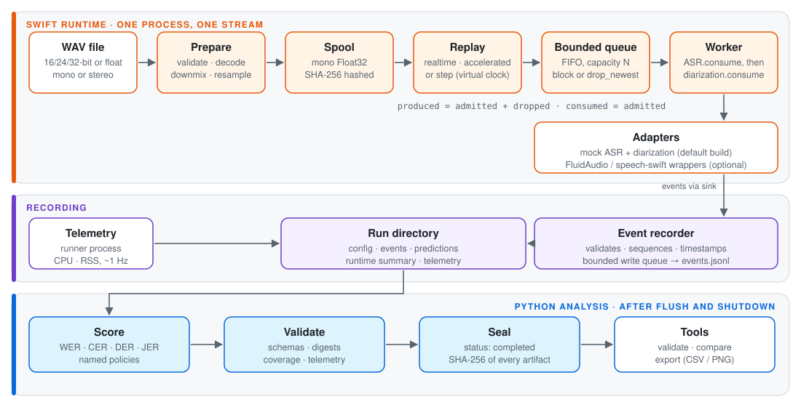

# Apple Silicon Streaming Speech Benchmark

A small, strict test bench for streaming speech models on the Mac. It plays a WAV file into speech
recognition (ASR) and speaker-diarization adapters the way a live stream would. It accounts for
every audio sample on the way, and it writes each run to disk as sealed, schema-checked files that
a separate Python layer scores.

> [!NOTE]
> **This is the benchmark harness, not the voice engine yet.** The default build runs deterministic
> mock adapters only, so it performs no speech recognition and needs no models. Optional builds add
> wrappers around pinned [FluidAudio](https://github.com/FluidInference/FluidAudio) and
> [speech-swift](https://github.com/soniqo/speech-swift) Core ML models (Parakeet EOU ASR, Sortformer
> diarization). They were used in one historical 12-run campaign, and each of those runs activated a
> single model role. An integrated voice engine (simultaneous ASR and diarization, microphone input,
> VAD workflow, service API) is planned and has **not** been built.

<p align="center">
  <picture>
    <source media="(prefers-color-scheme: dark)" srcset="docs/assets/architecture-dark.svg">
    
  </picture>
</p>

**Jump to:** [Try it](#quick-start-mock-adapters) · [How it works](#how-it-works) ·
[What was measured](#results-context-historical-campaign-20261021-s2) · [Limits](#limitations-and-roadmap) ·
[Docs](#documentation)

## Why build the harness first

Streaming speech numbers are easy to get subtly wrong. A resampler adds or drops a frame, a queue
quietly throws audio away under load, wall-clock time leaks into a run that was meant to be
deterministic, or a nice-looking result can't be re-checked a week later. I wanted those problems
closed before writing an engine, so that whatever comes next is measured against evidence rather
than impressions. This repository is that measurement layer.

## Quick start (mock adapters)

Needs macOS with a Swift 6.2+ toolchain and Python 3.12. It was tested on an Apple M5 with macOS 26.6.2,
Swift 6.3.2 (Command Line Tools) and Python 3.12.14; other setups are untested ([Requirements](#requirements)).

```sh
git clone https://github.com/Atharvavp/apple-silicon-voice-engine.git
cd apple-silicon-voice-engine
bash scripts/setup.sh      # Python 3.12 venv (hash-locked), doctor, default release build
bash scripts/smoke.sh      # one mock run: run, validate, export, check
```

With warm package caches, setup took about 2 minutes on the tested Mac and the smoke run about 5 s.
A first install downloads roughly 40 Python wheels and two Swift packages.

When it works, the last lines look like this:

```text
smoke check: pass (192000 samples consumed, 0 dropped, mock adapters, validation pass)

Smoke run passed. Output: <repo>/runs/smoke-<timestamp>-<pid>
```

The mock scores (`wer 0.400000`, `cer 0.153846`, `der 0.250000`, `jer 0.416667`) are deliberate
scripted errors on tones and silence. They show that the scorers and the pipeline joins work. They
say nothing about speech recognition. Timing and memory values depend on the machine.

<details>
<summary><b>What <code>setup.sh</code> and <code>smoke.sh</code> actually do</b></summary>

`setup.sh` finds `python3.12` on your `PATH`, or you can pass `--python /path/to/python3.12`. It
checks the version before creating `.venv`. It reuses a compatible `.venv` and refuses to touch an
incompatible one. It installs only the hash-locked analysis dependencies and never installs
Homebrew or Xcode, uses sudo, downloads models or accepts licenses. Rerunning it is safe.

`smoke.sh` replays the committed 12-second synthetic fixture (tones and silence, 192,000 samples at
16 kHz) through the mock adapters in step mode. It writes to a **new** directory under `runs/` and
then checks the result: run `completed`, mock adapters, 192,000 samples produced, admitted and
consumed, 0 dropped, sealed artifact hashes intact, validation `pass`, export files present.

</details>

<details>
<summary><b>The same steps by hand</b>, including a second run and a comparison</summary>

```sh
export PHASE1_FRAMEWORKS=none                     # default mock-only graph
swift build --disable-keychain -c release
.build/release/voicebench --version               # 0.7.0-phase0 (schema 1.0; phase1 frameworks: none)
.build/release/voicebench run --config configs/mock-step.yaml --runs-dir runs --run-id first-run
.build/release/voicebench validate --run runs/first-run
.build/release/voicebench export --run runs/first-run --out exports/first-run
.build/release/voicebench run --config configs/mock-step.yaml --runs-dir runs --run-id second-run
.build/release/voicebench compare --runs runs/first-run runs/second-run --profile accuracy --out comparisons/first-vs-second
```

Run IDs and output directories must be new: nothing is ever overwritten. `validate --run` writes a
new report under the run's `derived/` directory. It runs the analysis interpreter recorded in that
run's frozen config, so use it on runs you created yourself ([CLI reference](docs/cli.md)).

</details>

<details>
<summary><b>What a run directory contains</b></summary>

| File | Contents |
|---|---|
| `status.json` | Lifecycle state (`completed`, `failed`, `cancelled`), failure, and SHA-256 of every sealed artifact |
| `config.json` | The frozen effective configuration and resolved paths |
| `events.jsonl` | Every typed event: stages, chunk delivery and consumption, adapter partials/finals, lifecycle |
| `predictions.json` | Final transcript and speaker segments assembled from final events |
| `runtime_summary.json` | Sample coverage (produced/admitted/consumed/dropped), conversion record, queue depths, phase durations |
| `telemetry.jsonl` | About 1 Hz samples of the runner process: CPU time, resident size, footprint |
| `metrics.json`, `validation.json` | Python scoring and the initial sealed validation |
| `environment.json` | Host, toolchain, build and Python facts |

</details>

## Pick your path

| If you want to… | Start here |
|---|---|
| See it run in a few minutes, with no models | [Quick start](#quick-start-mock-adapters) |
| Follow audio through the runtime | [docs/architecture.md](docs/architecture.md) |
| Check how WER, DER and the timing metrics are defined | [docs/benchmarking.md](docs/benchmarking.md) |
| Read the one real-model campaign, caveats included | [Results](docs/phase1/PHASE_1_RESULTS.md) and the [evidence packet](docs/phase1/evidence/20261021-s2/README.md) |
| Run real models yourself | [Phase 1 guide](docs/phase1/README.md) |
| Wrap a new ASR or diarization framework | [Adapter guide](docs/phase1-adapter-guide.md) |
| Run the checks or contribute | [docs/development.md](docs/development.md), [CONTRIBUTING.md](CONTRIBUTING.md) |

## How it works

Reading the diagram at the top from left to right: the runner validates and decodes a local WAV, then downmixes and resamples it into a
hashed mono spool. The spool is cut into integer-sample chunks and replayed on a schedule into a
bounded queue. One worker hands each chunk to the ASR adapter and then to the diarization adapter,
in that order. Adapters report through a sink to a recorder that assigns sequence numbers and
timestamps. After flush and shutdown, the Python analysis scores the final predictions against
references and validates every artifact. The runner then seals the run. Nothing in the pipeline
captures a microphone, runs VAD as a separate stage or measures accelerator use.

In the historical real-model campaign, each run had **one** active real adapter and a passive
counterpart in the other role. The diarization wrappers emit their whole timeline at flush, and the
"bounded" queue and recorder do not mean that every retained trace has bounded memory. See
[docs/architecture.md](docs/architecture.md) for modules, clocks, lifecycle and state ownership.

Each of these is a mistake that is easy to make in a streaming benchmark, and this is how the
harness deals with it:

| Easy to get wrong | What the harness does | Where |
|---|---|---|
| The resampler changes the length by a frame | Computes the exact intended length. A native ±1-frame difference is corrected *and recorded*, or refused under the strict policy | [AudioPreparation.swift](Sources/AudioCore/AudioPreparation.swift) |
| The queue drops audio without anyone noticing | Every chunk is produced, admitted or dropped, then consumed. The run fails unless `produced = admitted + dropped` and `consumed = admitted` | [ReplayTrace.swift](Sources/Replay/ReplayTrace.swift) |
| Bytes change between preparation and replay | The spool is hashed, and replay re-hashes every byte it hands out | [FrameIterator.swift](Sources/Replay/FrameIterator.swift) |
| Wall time leaks into a "deterministic" run | Step mode runs on its own virtual clock. All real timestamps come from one run clock | [ReplayScheduler.swift](Sources/Replay/ReplayScheduler.swift) |
| Cancellation hangs or loses a waiter | Queue waiters resume exactly once on close, failure or cancellation, checked by a deterministic test with a watchdog | [BoundedQueue.swift](Sources/Replay/BoundedQueue.swift) |
| Results that can't be re-checked later | Strict JSON/YAML, typed events, a frozen v1 schema bundle, SHA-256 seals, outputs never overwritten | [contracts](docs/contracts.md) |
| Scores drift between tools | Named normalization and scoring policies, hand-derived goldens, Swift/Python parity tests | [testdata/goldens](testdata/goldens) |

On the tested Mac the model-free checks are 212 Swift tests and 289 Python tests. That was a local
run on 2026-10-27; GitHub Actions has not run yet, so there is no CI badge.

<details>
<summary><b>Full capability table</b>: what works today and what doesn't</summary>

| Area | Implemented | Not supported |
|---|---|---|
| Input | RIFF WAV (PCM 16/24/32-bit, Float32), mono or stereo (fixtures cover 11.025–96 kHz). Explicit arithmetic-mean downmix and AVAudioConverter resampling to 16 kHz, with endpoint corrections disclosed | Microphone or live input, compressed/RF64/multichannel (>2) files |
| Replay | `realtime` and `accelerated` (absolute deadlines on one clock, rational speed), `step` (deterministic virtual time, acknowledgment barrier) | Measured saturated throughput (the real-model campaign used 1× pacing) |
| Backpressure | Bounded FIFO audio queue with `block` or `drop_newest`; every admitted, dropped and consumed sample is accounted for | Drop-oldest. A bounded queue does not bound total retained history |
| Adapters | Scripted mock ASR and diarization (default). Optional FluidAudio / speech-swift wrappers, one role per adapter | Running two real models together; word timestamps; online speaker labels (real diarization emits its timeline once, at flush) |
| Artifacts | Frozen config, event trace, final predictions, runtime summary, runner-process telemetry, all with SHA-256 seals | GPU/ANE placement, power, thermal or model-only memory |
| Analysis | Strict schema validation (schema v1, frozen), WER/CER, DER/JER with explicit policies, run comparison with compatibility rules, CSV/PNG export | Standard AMI benchmark scoring (campaign references are project-specific projections) |

</details>

## Results context (historical campaign 20261021-s2)

On one Apple M5 (16 GiB, macOS 26.6.2), four configurations × three fresh-process runs replayed
the first 1,039.88 s of the AMI ES2008a headset mix at 1× pace. All 12 runs completed and validated,
each consuming all 16,638,080 samples with zero dropped. Each run activated one model role.
Accumulated active-adapter `consume`/`flush` wall time was about 79–90 s per replay (service RTF
0.077–0.086). That figure includes wrapper and sink work during paced input. It is **not** a
throughput measurement, and its inverse does not mean "x times faster than real time".

> [!WARNING]
> Accuracy values exist but are **conditional**. An automatic alignment check failed its
> uncalibrated threshold and no manual listening check has been recorded. The references are
> project-specific projections, not standard AMI scoring. Model conversions, precision and
> post-processing differ between frameworks, so the rows do not rank frameworks. Read the
> [corrected results](docs/phase1/PHASE_1_RESULTS.md) and the
> [public evidence packet](docs/phase1/evidence/20261021-s2/README.md) before citing any number.

## Optional real models

Real adapters are compiled only with `PHASE1_FRAMEWORKS=fluid|speech|both`, and they load only
model files that you have obtained and verified yourself. The
[Phase 1 guide](docs/phase1/README.md) covers the pinned SDK revisions, the owned speech-swift patch,
model and dataset licenses, a complete inputs template, AMI preparation, sandboxed smoke runs and
the full measured campaign. Nothing is downloaded or accepted on your behalf, and the measured
campaign takes hours of paced replay.

## Requirements

Tested on one Apple M5 running macOS 26.6.2, with Swift 6.3.2 (Command Line Tools) and Python
3.12.14. Everything else in the table is declared but untested.

<details>
<summary><b>Full requirements</b></summary>

| | Tested | Declared but not tested |
|---|---|---|
| Mac | Apple M5, arm64, macOS 26.6.2 (25G83) | Package floor macOS 13 (default build), 14 (FluidAudio build), 15 (speech-swift build). Intel Macs and other macOS versions are untested |
| Swift | 6.3.2 with Command Line Tools only (`scripts/swift_test.sh` adds the Swift Testing paths CLT needs) | `swift-tools-version: 6.2`; Xcode toolchains |
| Python | 3.12.14 (the analysis package requires 3.12.x) | Other 3.12 patch releases |
| Network | Needed once, for setup (PyPI wheels, SwiftPM packages from GitHub) | — |
| Disk (observed, not a minimum) | ~0.4 GB `.venv`, ~1.5 GB `.build` after the default build and tests | Optional SDK builds used ~4.3 GB `.build` plus ~50 MB of vendored source |

The Command Line Tools' Swift Testing framework is built for macOS 14, so tests print a linker
warning on the macOS 13 default target.

</details>

## Limitations and roadmap

- There is no integrated voice engine. Real models have only been run one role at a time, on
  prerecorded audio.
- There are no word timestamps, first-word or end-of-utterance latency, or online speaker-label latency.
- Throughput, accelerator placement, power and model-only memory have not been measured.
- Evidence comes from one machine and one 17-minute meeting. Accuracy is conditional until the
  manual alignment check is done.
- The speech-swift A2 configuration has documented native finalization limits
  ([follow-up results](docs/phase1/PHASE_1_FOLLOWUP_RESULTS.md)).

The [roadmap](docs/roadmap.md) separates what is implemented, pending and planned.

<details>
<summary><b>Repository map</b></summary>

```text
Sources/BenchmarkSupport     JSON/YAML strictness, config, manifests, events, clocks
Sources/AudioCore            WAV inspection/decode, downmix, resampling, PCM spool, sample clock
Sources/Replay               replay scheduler, bounded queue, virtual clock, frame iterator, coverage
Sources/AdapterContracts     streaming adapter protocols and event validation
Sources/MockAdapters         scripted ASR and diarization mocks
Sources/CTelemetry, Telemetry  runner-process CPU/memory sampling, build facts
Sources/Experiment           runner, recorder, lifecycle, provenance, Python bridge
Sources/RealAdapterSupport   shared wrapper logic for real adapters (always compiled; model-free)
Sources/FluidAudioAdapters   optional FluidAudio wrappers (PHASE1_FRAMEWORKS=fluid|both)
Sources/SpeechSwiftAdapters  optional speech-swift wrappers (PHASE1_FRAMEWORKS=speech|both)
Sources/BenchmarkCLI         `voicebench` run/validate/compare/export
Tests/                       Swift Testing suites (SpeechNativeEOUTests only in speech builds)
analysis/                    Python package `phase0_analysis` and hash-locked requirements
schemas/v1/                  frozen JSON Schemas (bundle SHA-256 in schemas/SCHEMA_BUNDLE_V1.sha256)
configs/                     mock experiment configs
datasets/, testdata/         synthetic fixtures, malformed-input corpus, manifests, goldens
scripts/                     setup/smoke, fixtures, checkpoints, Phase 1 campaign tooling
patches/                     the owned two-file speech-swift patch
docs/                        documentation index: docs/README.md
```

</details>

## Documentation

- [Documentation index](docs/README.md): current references and dated historical records.
- [Architecture](docs/architecture.md), [benchmarking methodology](docs/benchmarking.md),
  [CLI](docs/cli.md), [contracts](docs/contracts.md), [adapter guide](docs/phase1-adapter-guide.md).
- [Development and checks](docs/development.md), [roadmap](docs/roadmap.md),
  [dependencies](docs/dependencies.md).

## Contributing, security and license

See [CONTRIBUTING.md](CONTRIBUTING.md) for checks and scope, and [SECURITY.md](SECURITY.md) for
reporting and the trusted-run assumptions. Never attach private recordings, model weights or
credentials to issues.

Project-authored code, documentation and synthetic fixtures are MIT-licensed ([LICENSE](LICENSE)).
Dependencies, the speech-swift patch, model conversions and the AMI corpus keep their own terms
([THIRD_PARTY_NOTICES.md](THIRD_PARTY_NOTICES.md)). This repository does not redistribute model
weights or AMI audio.
