# Repository publication implementation plan

Prepared **2026-10-27 (Asia/Kolkata)** against local `imp/phase-1`, HEAD `e29f345abbdaa68cd496955b5e00f3fed86b140d`, plus the owner changes listed in the [audit](REPO_PUBLICATION_AUDIT.md). **Planning only: none of the changes below has been implemented.** Public/default `main` is `4a5d3ab…` with only README.

## 1. Release scope and priorities

Ship an approachable **Apple Silicon streaming speech benchmark**, with a synthetic mock quick start and optional pinned FluidAudio/speech-swift adapters. Describe the complete voice engine as future work. Preserve audio policies, schema v1 bytes, metrics definitions, existing adapter behavior, and historical campaign identities. Do not add microphone capture, production services, online diarization events, a new VAD workflow, model optimization or fresh performance campaigns to complete this release.

P0 findings F01–F03 block the proposed publication. P1 F04–F11 must be resolved or explicitly scoped out with a truthful documented limitation before sharing. P2 F12–F14 are targeted improvements; destructive output behavior should be fixed before recommending those advanced scripts as repeatable entrypoints. P3 work is deferred in §8.

Effort bands: **S** localized changes; **M** multiple coordinated files and verification; **L** cross-environment/data/owner-dependent work. Overall initial hardening is **M**, with **M–L** provenance packaging/real-model reproduction depending on evidence rights and asset availability. No unsupported elapsed-time estimate is implied.

## 2. Target structure: retain the implementation layout

Proposed additions are marked `+`. Keep existing directory names/case, Swift targets and Python package imports.

```text
README.md                              # rewritten entrypoint
LICENSE                             +  # only after owner's license choice
THIRD_PARTY_NOTICES.md               +  # scope + links/text required by dependencies
CONTRIBUTING.md                     +
SECURITY.md                         +
Package.swift
Package.resolved                        # default/mock dependency graph
.gitignore
.github/workflows/ci.yml             +  # scoped jobs, least privilege
.github/pull_request_template.md     +  # small; optional polish
Sources/                               # all 12 existing modules unchanged in layout
Tests/                                 # existing suites + reviewed native follow-up target
analysis/                              # current package, locks and tests
configs/                               # current mock experiment YAMLs
datasets/fixtures/                     # committed synthetic + malformed corpus retained
datasets/manifests/                    # current manifests; license metadata updated by decision
schemas/                               # frozen v1 bytes retained
testdata/                              # corpus/goldens retained
patches/                               # exact two-file speech-swift patch retained
scripts/
  setup.sh                          +  # small preflight/setup entrypoint
  smoke.sh                          +  # safe new output, mock assertions
  swift_test.sh                        # existing CLT wrapper
  ...                                  # reviewed existing scripts/follow-up audits
docs/
  README.md                         +  # current navigation + historical index
  architecture.md                   +
  benchmarking.md                   +  # methodology + reproduction ownership
  development.md                    +
  roadmap.md                        +
  cli.md                               # maintained reference
  contracts.md                         # maintained enforced contracts
  dependencies.md                      # current graph/license inventory
  phase1-adapter-guide.md               # extension contract guide
  phase1/
    README.md                          # complete optional model/data setup and stages
    PHASE_1_RESULTS.md                  # corrected canonical campaign narrative
    CODEX_INDEPENDENT_REVIEW.md         # reviewed owner work
    PHASE_1_FOLLOWUP_PLAN.md
    PHASE_1_FOLLOWUP_RESULTS.md
    history/                           # preserved, clearly superseded
    evidence/20261021-s2/            +  # only rights-approved small public summaries
  publication/                         # these four plans; later verification report
PHASE_0_READINESS_REPORT.md              # retained, clearly historical Phase 0
```

Ignored local-only: `.build/`, `.venv/`, `runs/`, root `evidence/`, `vendor/`, generated-large audio, `scratch/`; add generated `exports/` and `comparisons/` and narrowly scoped local input/work-file ignores. The proposed nested `docs/phase1/evidence/` is a curated packet. The existing unanchored `evidence/` ignore **also matches that proposed nested directory**, confirmed with `git check-ignore -v`; T40 must scope it to `/evidence/` after reviewing any other nested evidence. Do not bypass the rule with a blanket force-add.

Do not add CHANGELOG/release automation, rename `phase0_analysis`, move modules, consolidate tests for aesthetics, or introduce LFS for the small generated WAV corpus. The root Phase 0 report and narrative generator input can stay in place to avoid breaking tooling.

## 3. README and documentation specification

### README order and content

1. **Title/introduction:** “Apple Silicon Streaming Speech Benchmark” is a display-title proposal; keep URL/name unless the owner elects otherwise. Explain local WAV replay, streaming adapters, telemetry and separate Python evaluation in one paragraph.
2. **Status:** default build has deterministic mock adapters; optional builds contain four real configurations; 12 historical separate-role campaign runs exist; integrated production voice engine/microphone workflow is future work. A dependency product named SpeechVAD does not establish a public VAD pipeline.
3. **Capabilities:** sample accounting/endpoint disclosure, paced or step replay, queue policy, sealed outputs, scoring. Link limitations alongside capabilities.
4. **Requirements table:** tested macOS 26.6.2 arm64/Swift 6.3.2/Python 3.12.14; manifest tools 6.2 and macOS floors 13/14/15 are declarations, not tested OS coverage. CLT test framework requires macOS 14+ on the observed toolchain. Network is required for initial dependencies and separate optional asset acquisition. Measured 16 GiB host is a campaign fact, not a universal minimum. Do not invent minimum disk/RAM/runtime figures.
5. **Quick start:** clone URL once integrated main is available; enter checkout; verify Python 3.12 and Swift; setup; run mock; validate; inspect artifacts. Put setup before run. State network installation vs local execution and that synthetic audio is tones/silence.
6. **Architecture:** small Mermaid diagram below plus plain-text explanation; defer fields/details to architecture/contracts.
7. **Optional real models:** separate link to complete Phase 1 setup. Explicit external input paths, source/model pins, licenses, network/download budgets, build graph and sandbox constraints. Never imply default build runs real models.
8. **Methodology/results:** one concise historical execution statement, environment, single-role and paced-replay caveats, conditional accuracy status, link to canonical results and curated evidence. Withhold accuracy headlines unless the owner selects and completes that path.
9. **Repository map:** actual modules/directories, current docs and extension guide.
10. **Limitations/future work:** no word timestamps/online label latency/throughput/ANE/power claims; broader roadmap separately linked.
11. **Development/contribution/license/data:** verified checks, approved terms and third-party boundaries.

Suggested accurate architecture source (proposed content; verify GitHub rendering during implementation):

```mermaid
flowchart LR
    Config[Config and manifest] --> Runner[Swift experiment runner]
    WAV[Local WAV] --> Audio[Validate, decode, downmix, resample]
    Audio --> Spool[Hashed mono PCM spool]
    Spool --> Replay[Realtime, accelerated, or step replay]
    Replay --> Queue[Bounded FIFO: block or drop newest]
    Queue --> Worker[Worker: ASR then diarization]
    Runner --> Worker
    Worker --> Adapters[Mocks or optional real adapters]
    Adapters --> Recorder[Validated events and bounded recorder]
    Worker --> Recorder
    Telemetry[Runner process telemetry] --> Recorder
    Recorder --> Artifacts[Run artifacts and final predictions]
    Artifacts --> Python[Python validation and scoring]
    Python --> Seal[Metrics, validation, completed seal]
    Seal --> Export[Comparison and CSV or PNG export]
```



Caption must explain that campaign configurations activate **one** model role with a passive counterpart, real diarization output is final-only, and “bounded recorder/queue” does not mean every retained trace/model history has bounded total memory. Plain fallback: WAV → mono spool → replay → FIFO → sequential role calls → recorded artifacts → Python scoring/validation → seal/export. No node should suggest simultaneous ASR/diarization inference, microphone input, a VAD stage, or accelerator measurement.

### Single source of truth by document

| Document | Owns | Links rather than duplicates |
|---|---|---|
| README | Scope, first successful run, short requirements/result context | Exact methodology, all flags, historical logs |
| `docs/README.md` | Current navigation and historical archive index | Implementation walkthroughs |
| `docs/architecture.md` | Swift modules, streaming data path, ownership/clocks, lifecycle, bounded/unbounded state, Python boundary | Field lists in contracts/schemas |
| `docs/contracts.md` | Current enforced config/event/adapter invariants | Historical milestone status |
| `docs/cli.md` | Real flags, exit codes, new-output rules, trusted-run/path behavior | Full onboarding narrative |
| `docs/benchmarking.md` | Replay/time definitions, scoring policies, validity/comparability, output schema and workflow entrypoints | Campaign-specific numeric tables |
| `docs/phase1/README.md` | Pinned optional SDK/model/data setup, input template, stages, exact run/reproduction paths | Metric theory and results |
| `docs/phase1/PHASE_1_RESULTS.md` | Canonical 20261021-s2 results, caveats, corrections, evidence links | A second independently edited results overview |
| `docs/dependencies.md` / notices | Current graph pins, license provenance, setup/lock policies | Unqualified legal conclusions |
| `docs/development.md` / CONTRIBUTING | Commands, check matrix, extension workflow and review expectations | Repeated architecture details |
| `docs/roadmap.md` | Implemented/in-progress/planned boundaries | Implicit commitments or completion dates |
| Existing readiness/reviews/history | Dated evidence and correction history | Claims of current publication readiness |

## 4. Verified commands and proposed entrypoints

The following existing command sequence was **executed successfully in the audit snapshot**, using the existing Python 3.12 venv. It is the baseline for the README. It is not verified from public `main`, which currently lacks these files, or from a cold Python install.

```sh
export PHASE1_FRAMEWORKS=none
swift build --disable-keychain -c release
.build/release/voicebench --version
.build/release/voicebench run --config configs/mock-step.yaml --runs-dir runs --run-id publication-smoke
.build/release/voicebench validate --run runs/publication-smoke
.build/release/voicebench export --run runs/publication-smoke --out exports/publication-smoke
```

Expected version: `0.7.0-phase0 (schema 1.0; phase1 frameworks: none)` at the audited source. Expected run: completed, exit 0, `MOCK`; metrics/validation/predictions/status/events created. The 12-second tone fixture has 192,000 source samples at 16 kHz; step mode does not wait 12 seconds of real time. No precise wall-clock completion promise. Reusing the same run ID/output is refused; choose a new output rather than deleting prior evidence.

Optional comparison, also executed successfully:

```sh
.build/release/voicebench run --config configs/mock-step.yaml --runs-dir runs --run-id publication-smoke-b
.build/release/voicebench compare --runs runs/publication-smoke runs/publication-smoke-b --profile accuracy --out comparisons/publication-smoke
```

The synthetic scores deliberately contain errors. `validate --run` writes a **new derived validation**; initial artifacts remain sealed. It uses the run's frozen absolute analysis paths, so it is appropriate for trusted locally generated runs. For read-only examination of copied campaign evidence, use the trusted current Python module with explicit `--schemas` and external `--out`; do not silently modify sealed config paths.

Other checks executed successfully:

```sh
export PYTHONPATH="$PWD/analysis/src" MPLBACKEND=Agg PYTHONDONTWRITEBYTECODE=1
.venv/bin/python -m pip check
bash scripts/swift_test.sh --disable-keychain --no-parallel
.venv/bin/python -m pytest analysis/tests -q
.venv/bin/python scripts/generate_fixtures.py --small --out datasets/fixtures --verify
```

`--no-parallel` passed in the audit (via already-built tests), while the concurrent suite had a recorded timing failure. This command is a temporary diagnostic option until T50 defines the stable gate; it is not permission to hide the failure.

New `scripts/setup.sh` and `scripts/smoke.sh` below are **proposed interfaces**, not existing verified commands. Do not put them in README as working until implemented and tested. No Makefile is needed initially; a later `make setup/smoke/test` may delegate to these scripts if useful.

Cold setup candidate uses an interpreter selected by `command -v python3.12`, checks exactly major/minor 3.12, creates `.venv`, installs the existing hash-locked development requirements and runs `pip check`/doctor. `/opt/homebrew/bin/python3.12` was confirmed available here; its venv-creation/install commands were not rerun. Never replace `python3.12` with ambient 3.14 or claim the cold install was tested in this audit.

## 5. Phased tasks

Each task states required files, dependencies, instructions, expected artifacts, verification, acceptance and rollback. Existing command flags were source-inspected or executed as stated; new scripts/tests/CI are acceptance targets to implement. `<new-…>` and input variables denote deliberately new caller-selected paths and must be made concrete for each execution.

### Phase 0 — baseline, preservation and reviewable branch

#### T00 — Preserve the actual working state (P1, M; F07)

- **Files:** all paths in audit §3; especially changed manifest/report/results and untracked native tests, Python audit tests, review/history and `scripts/phase1_followup/`.
- **Dependencies:** none. **Approval:** no destructive operations; owner decision needed only for any proposed omission/disposition of owner work.
- **Instructions:** record exact HEAD, branch, status, tracked diff and file hashes outside the source tree; inventory untracked files and ignored evidence metadata. Read local instructions. Preserve the four audit plans. Use a separate local branch/checkout containing the intended working snapshot; do not reset/stash/clean the original or `git add -A`. Review each existing change as owner work; include coherent dependencies explicitly. Keep ignored datasets/models/evidence private.
- **Expected artifact/behavior:** reproducible baseline manifest, explicit include/exclude table, intact original checkout.
- **Verification:** `git status --short --branch`, `git branch -vv`, `git rev-parse HEAD`, `git diff --stat`, `git diff --check`, `git ls-files --others --exclude-standard`; before/after content hashes.
- **Acceptance:** every pre-existing changed file remains byte-identical in the original checkout unless a later approved implementation edit is intentional; no required native target or correction link omitted.
- **Regressions/risk:** missing untracked dependencies, accidentally publishing `diff.txt`/authorization notes. **Rollback:** abandon only the newly created publication branch/checkout after preserving its work; never remove owner files.

#### T01 — Assemble the publication candidate without merging (P0, M; F01/F07)

- **Files:** full tracked implementation, reviewed owner work, these four deliverables; no runtime architecture moves.
- **Dependencies:** T00.
- **Instructions:** create a local `publication/readiness` branch from the complete verified implementation snapshot, not the two-line main. Bring the owner changes in as reviewed, logically separate changes. Record divergence from `main`. Use small explicit commits only if the implementation session authorizes local commits; this planning pass authorizes none. Do not integrate to main yet.
- **Expected artifact/behavior:** a reviewable branch/diff containing Swift/Python/config/schema/fixture code and corrected documentation; complete source available for clean-clone tests.
- **Verification:** `git diff main...HEAD --stat` for committed work plus `git diff --stat` for uncommitted work; compare package test-target directories and docs links with inventory; default build/test matrix in §6.
- **Acceptance:** candidate contains the full harness and all required corrections, with no ignored/private assets. Existing model-free behavior is preserved. PR base will be `main` once authorized.
- **Regressions/risk:** using only Phase 0 remote branch loses Phase 1; branch/diff can omit unstaged files. **Rollback:** keep candidate separate; revert only new task changes on the candidate, preserving baseline.

### Phase 1 — publication blockers and claim boundaries

#### T10 — Correct scope claims everywhere current (P0, S; F02)

- **Files:** `README.md`, `docs/README.md` (new), current Phase 1 guide/results where needed; proposed GitHub metadata recorded for owner.
- **Dependencies:** T00; final README structure coordinated with T30.
- **Instructions:** replace the complete-engine introduction with harness description; identify default mocks vs optional real adapters; state campaign one active model/role at a time. Mark microphone/live engine/VAD integration as planned. Preserve corrected service-RTF interpretation and explicitly unavailable metrics. Add a dated banner/link to the historical Phase 0 readiness report without rewriting its original evidence. Prepare description: “Swift/Python benchmark harness for streaming ASR and diarization on Apple Silicon, with sample-exact replay and reproducible evaluation.”
- **Expected artifact/behavior:** current landing documents make no unsupported complete-engine/performance claims; settings proposal ready for owner.
- **Verification:** review each hit of `rg -n 'fully on-device|voice intelligence engine|faster than real time|ANE|word.*latency|simultaneous' README.md docs`; classify historical quotations/corrections rather than deleting them blindly.
- **Acceptance:** current scope is understandable in the opening paragraph and agrees with actual adapters and campaign matrix. Historical withdrawn wording remains clearly marked, not surfaced as a current result.
- **Regressions/risk:** erasing technical motivation or correction history. **Rollback:** restore wording from baseline on candidate only; do not publish until truthful replacements reviewed.

#### T11 — Obtain rights decisions and complete notices (P0, M; F03)

- **Files:** proposed `LICENSE`, `THIRD_PARTY_NOTICES.md`; `docs/dependencies.md`, `README.md`; generator rights strings in `scripts/generate_fixtures.py`, `datasets/manifests/synthetic.json`; approved model/data provenance summaries.
- **Dependencies:** T00. **Owner approval required:** code/document/fixture license selection and exact redistribution scope. No fabricated legal clearance.
- **Instructions:** inventory both default and optional graph licenses from pinned checkout license files, including local speech source and embedded libyaml; distinguish code, SDK linkage, converter scripts, original weights and converted weights, AMI data/annotations, generated fixtures and derived reports. Cite revision-specific primary notices. Do not infer all 41 resolved packages are linked into the executable. Add the owner-selected license with appropriate scope and required notices; if approval is pending, complete the inventory and mark the publication gate pending. Update synthetic rights metadata/generator consistently only after approval, without altering audio/reference bytes; preserve historical sealed manifests.
- **Expected artifact/behavior:** approved reuse terms for project-authored files; discoverable third-party/data/model boundaries. No weights or real recordings added.
- **Verification:** inspect `git ls-files` for license/notice coverage; `pip check`; doctor distribution inventory; fixture `--verify`; schema tests. Review generator/manifest diff and unchanged WAV/reference hashes. Existing old runs must still validate against their original manifests.
- **Acceptance:** owner approval recorded; license visible on repository; all deliberately distributed artifacts accounted for. Binary redistribution stays out of scope until notices are sufficient. No unresolved rights item is labelled approved.
- **Regressions/risk:** metadata drift breaks fixture verification; blanket license claim over third-party assets. **Rollback:** revert new license/metadata changes on candidate if incorrect; leave gate pending, never change historical evidence or audio to manufacture agreement.

#### T12 — Choose a defensible results publication scope (P1, M; F06)

- **Files:** `docs/phase1/PHASE_1_RESULTS.md`, `PHASE_1_FOLLOWUP_RESULTS.md`, `README.md`, proposed `docs/benchmarking.md` and evidence index.
- **Dependencies:** T10, T11 for exported evidence. **Owner decision:** whether to complete manual alignment now or publish only a methodology-focused case study with conditional accuracy.
- **Instructions:** retain existing measured values/corrections. If manual validation is chosen, follow the pre-existing plan's Experiment A with owner listening; record actual observations, no inference substituted for listening. If deferred, mark accuracy conditional, withhold validated-accuracy/winner headlines, and make the failed acoustic check visible near scores. Do not rerun B/C/D/E or fix native decoder behavior as a publication shortcut. Preserve A2 identity and its unauditable EOU-frame limitation.
- **Expected artifact/behavior:** explicit execution-validity vs reference-validity status and current permitted/unsupported claim table.
- **Verification:** compare every selected numeric/qualitative statement with frozen matrix, metric records, review and follow-up results. Confirm the stated RMS failure/listening status against dataset freeze. Owner reviews any caption that will accompany release.
- **Acceptance:** conditional data is never presented as validated standard AMI accuracy; service RTF never converted to saturated throughput; single meeting/role and conversion confounds remain adjacent to results.
- **Regressions/risk:** accidentally broadening a historical verdict or tuning references to models. **Rollback:** restore original preserved report; append correction/versioned derived scoring if new evidence changes interpretation, never overwrite sealed source results.

### Phase 2 — reproducible onboarding

#### T20 — Small, explicit environment setup (P1, M; F04)

- **Files:** proposed `scripts/setup.sh`; `README.md`, `docs/development.md`; use existing analysis locks/doctor and CLT test wrapper.
- **Dependencies:** T11 for public terms, T23 for default lock policy. May be developed while approval is pending.
- **Instructions:** shell strict mode, quoted paths, repository-root discovery, clear arm64/macOS/Swift toolchain/Python 3.12 diagnostics. Accept an explicit Python executable or discover `python3.12`; verify version before creating `.venv`. Refuse to replace a wrong-version existing venv. Install with `--require-hashes -r analysis/requirements-dev-macos-arm64-py312.lock`, then `pip check` and doctor. Explain network step; never install Homebrew/Xcode, accept licenses, download models, use sudo or recursively delete user data automatically. Rerunning a valid setup should reuse the environment. Avoid unneeded dependency upgrades/lock regeneration. Offer the verified explicit underlying commands for users who prefer them.
- **Expected artifact/behavior:** one setup entrypoint, actionable errors, no absolute author-specific Python requirement, no side effects outside declared dependency/cache locations.
- **Verification:** run the new script on a new temporary checkout with a **new venv**, then again; test a selected Python 3.14 executable and an existing incompatible venv in temporary directories; doctor/pip check. Record initial downloads and cache state. These are new interface checks, not pre-existing verified commands.
- **Acceptance:** cold supported-host setup succeeds from documented instructions; bad interpreter fails before touching existing environment; original root lock/source unchanged. Network/offline distinction correct.
- **Regressions/risk:** environment replacement; install failures; slow dependency resolution. **Rollback:** revert script/docs; retain existing explicit setup recipe and user venv. Do not delete a failed user environment automatically.

#### T21 — Safe model-free smoke path (P1, M; F04)

- **Files:** proposed `scripts/smoke.sh`; existing `configs/mock-step.yaml`, committed synthetic fixture; README; a small assertion helper/test only if needed.
- **Dependencies:** T20/T23.
- **Instructions:** build default `PHASE1_FRAMEWORKS=none`; use a freshly allocated directory under ignored `runs/` (or caller's new `--out`), with two fixed child IDs only inside that new directory. Run production mock CLI, validate, optionally export. Assert completed/non-lossy/mock state, 192,000 consumed samples, valid artifact digests/validation status and required files. Print location and next inspection step. Preserve existing run-ID/output refusal; no recursive removal. Do not use long acceptance scripts as the beginner smoke or fetch a model. Do not package an ignored absolute-path run as a portable executable example.
- **Expected artifact/behavior:** one beginner command after setup, no proprietary data/model, repeatable without overwriting prior output. Underlying commands from §4 remain available.
- **Verification:** execute twice from new checkout; assert two distinct retained directories; test an existing explicit output containing a sentinel is unchanged. Inspect `status.json`, `runtime_summary.json`, `predictions.json`, validation and exported files; revalidate through trusted Python/CLI.
- **Acceptance:** mock is unmistakable; basic artifact/accounting checks pass; no private data or model/cache download; successful output documented without variable timing thresholds.
- **Regressions/risk:** false-positive success that checks only exit code; changed config resolution. **Rollback:** remove only new script changes from candidate; use §4 manual verified commands while preserving generated runs.

#### T22 — Complete optional real-model recipe (P1, M–L; F05)

- **Files:** `docs/phase1/README.md`, `docs/dependencies.md`, proposed redacted input template under `docs/phase1/`; `scripts/run_phase1.py`/`prepare_phase1_data.py` only for demonstrated diagnostics/provenance gaps; no SDK inference changes.
- **Dependencies:** T11, T12, T23, T41 for vendor identities.
- **Instructions:** derive a **complete** template from current parser requirements and four matrix rows; no ellipses or pretending placeholder acceptance is valid. Set acceptance false/pending in example; require the user's actual acceptance. Distinguish model repository/revision, exact selected file sets, load paths, model geometry, asset hashes, data layout, AMI annotation version/crop policy, model and dataset licenses. Never copy local absolute roots, owner statements, private emails or transcripts. Document manual revision-pinned acquisition and byte/disk budget from reviewed metadata; do not add `huggingface-hub`/model packages to the analysis venv because doctor forbids them. Include separate environment/tool instructions if acquisition needs a client. No acquisition is automatic or represented as approved.
- **Workflow:** initialize `INPUTS` to a real private local file and `SESSION` to a new directory, quote both and `VB`; optional build lists compiled frameworks via `--version`; run existing snapshot → prepare-data → campaign **`--skip-measured`** smoke/negative controls → verify → report as appropriate. A separate measured recipe explains ~4 hours or more for 12 × 1039.88 s paced runs plus setup/cooldowns, variable by host; do not automatically run it. The smoke stage still needs real models/data and macOS sandbox controls. Document setup network vs network-denied inference. Inputs unavailable = blocked/NOT_RUN, not “reproduced.”
- **Expected artifact/behavior:** a new engineer can supply their own lawful assets and invoke every documented stage; clear missing-prerequisite errors. Historical exact binary reproduction distinguished from source rebuild.
- **Verification:** execute `--help` for actual subcommands in the implementation session; parser/template unit checks; existing `test_phase1_data.py`, `test_phase1_campaign.py`, `test_phase1_report.py`; clean optional source build/stub tests if supported. Native asset smoke and full measured reproduction require separately authorized acquisition/compute; otherwise mark explicitly NOT RUN.
- **Acceptance:** all four configurations have complete source/asset identities, acquisition instructions, file layout and caveats; no unbound shell variables; commands not run are labelled. Missing speech vendor fails clearly; no mocked SDK tests advertised as model inference.
- **Regressions/risk:** source revisions drift, changed asset geometry or licensing, excessive downloads. **Rollback:** restore prior guide and keep explicit unverified/blocked status; never change pins or assets silently to make commands pass.

#### T23 — Align lock policy with the default graph (P1, M; F11)

- **Files:** `Package.resolved`, `docs/dependencies.md`, `docs/phase1/README.md`; approved provenance packet containing the original both-graph `Package.resolved`.
- **Dependencies:** T00; preserve original both lock before mutation; public packet approval under T11/T31.
- **Instructions:** record full original lock SHA `aee60879806d3b495c2794a43743114016a2803e8053d97fc350fc83644c2a3f`. Preserve exact historical both lock as provenance (not regenerated). Make root lock the resolved default/none graph using the current exact argument-parser/Yams pins in an isolated checkout. Inspect that only intended packages remain and no direct revisions moved. Document that optional build graphs rewrite the root lock, and run them in a disposable dedicated checkout using the historical both lock where applicable. A source rebuild with different transitive resolution is a new provenance identity, never the original campaign binary. Do not add a wrapper that overwrites/restores someone's lock without checking their work.
- **Expected artifact/behavior:** repeated default build leaves no tracked lock diff; optional workflow and historical graph are explicit.
- **Verification:** record before/after SHA, `git diff -- Package.resolved`; twice run `PHASE1_FRAMEWORKS=none swift build --disable-keychain` after setting intended root lock; default release/test; optional graph build in its isolated checkout. Verify historical copy SHA exactly. No automatic resolution updates beyond the reviewed graph change.
- **Acceptance:** clean default build; original both lock recoverable and notices inventory matches each described graph. Model profile dependency-lock identities in historical files unchanged.
- **Regressions/risk:** transitive upgrades, optional build incompatibility, mutable path dependency misunderstood. **Rollback:** restore baseline root lock, retain both bytes/provenance, document default dirty-build limitation until resolved; do not update historical profiles.

### Phase 3 — current README, architecture and evidence

#### T30 — Implement the landing page and current doc navigation (P1, M; F04/F10)

- **Files:** `README.md`, proposed `docs/README.md`, `docs/architecture.md`, `docs/benchmarking.md`; maintained `docs/cli.md`, `docs/contracts.md`, `docs/api-verification.md`.
- **Dependencies:** T10/T20/T21; T12/T31 determine results selection.
- **Instructions:** implement §3 content/ownership and diagram; put first-run instructions before deep history. Update current contract/API version statements against source; label old measurements by date/environment. Include actual role-call order, spool/endpoint/hash semantics, all replay modes and queue policies, lifecycle/scoring boundaries. Explain sample exactness separately from SDK SRC/acoustic alignment. Document output semantics, WER/CER/DER/JER policy, step virtual-vs-real clocks, comparison compatibility and noncomputable metrics. Preserve historical ledger entries as dated facts rather than silently replacing them with present claims. Fix relative links/anchors and inline-code references essential to visitors.
- **Expected artifact/behavior:** GitHub → README → smoke → architecture/results/source can be followed without development history.
- **Verification:** execute every new README command in order on candidate clone; explicit relative-link target/anchor check; render Mermaid in GitHub or compatible preview; compare every architecture edge and capability with code; `git diff --check`.
- **Acceptance:** no command before prerequisites; no nonexistent compare inputs; no schema/version or implemented/planned contradiction in maintained docs; external links and diagrams reviewable. No badge implies a pass without a real check run.
- **Regressions/risk:** excessive duplication; inaccurate diagram; losing API details. **Rollback:** revert new doc set together; keep existing deep sources and corrected current scope.

#### T31 — Curate a small public results evidence packet (P1, M; F06)

- **Files:** proposed `docs/phase1/evidence/20261021-s2/{README.md,provenance.json,results-per-run.csv,results-summary.csv,Package.resolved}` and optional reviewed aggregate JSON/figures; canonical report links. Actual included names may be reduced if owner restricts rights; record the manifest.
- **Dependencies:** T11/T12/T23 and T40's narrow root-evidence ignore correction before staging the packet; **owner approval required** for export/redistribution scope and any external hosting.
- **Instructions:** copy only approved original aggregate bytes; keep historical originals unchanged. Include hardware/OS/toolchain/framework/model/patch/schema/lock/binary IDs, four profile revisions, audio/crop/reference hashes, policy names, 12 run IDs, distinct repetitions, sample accounting, audit date/methods and scientific caveats. Include original selected file hashes and any published-file hash separately. A redacted derivative has a new hash; never claim it matches the original sealed artifact. Do not include transcript text, real audio, model weights, local root paths, owner input statements or full event traces by default. Document which omitted raw data is not publicly independently inspectable. State whether summaries are sufficient for recomputation; if raw inputs are withheld, do not call them a full reproduction bundle. Prefer <= a few MB of intentional checked-in evidence; larger hosting is optional and owner-approved.
- **Read-only validation:** for approved intact local runs, Python `-m phase0_analysis validate --run <run> --schemas schemas/v1 --out <new-external-report>` reads without adding `derived/` to originals. CLI `validate` is reserved for new local runs. Hash/score existing raw campaign read-only; do not silently rewrite path fields. No need to copy the preserved binary into Git.
- **Expected artifact/behavior:** figures/claims resolve to available machine-readable summaries and precise original identities; public limitations about omitted evidence are visible.
- **Verification:** recompute summary medians/min/max and per-run metric records from originals; rehash approved exports; secret/path scan curated packet; inspect CSV encodings/units; follow canonical report links from a fresh candidate clone.
- **Acceptance:** numbers and units match; explicit distinction between checks reproduced here and historical evidence; legal/privacy scope approved; no broken local-only references required for understanding. If approval unavailable, public README omits numeric snapshot and clearly says evidence publication pending.
- **Regressions/risk:** privacy leakage, corrupting originals, overstating reproducibility. **Rollback:** remove only newly prepared exports from candidate (owner approval for any destructive removal); originals retained. Narrow claims until packet is approved.

#### T32 — Label historical material and define the roadmap (P1, S–M; F10)

- **Files:** `PHASE_0_READINESS_REPORT.md`, `docs/M2_HARDENING_REPORT.md`, `docs/implementation-log.md`, `docs/decisions.md`, `docs/readiness-narrative.md`, `docs/phase1/history/*`, proposed `docs/roadmap.md`/index.
- **Dependencies:** T30.
- **Instructions:** add clear index labels for historical reports and superseded results; maintain existing paths and generator inputs. Link Phase 0 Gate A to its historical scope and current Phase 1 to corrected results. Keep pending English/Hindi staging templates honest; AMI Phase 1 manifests are separate generated inputs. Roadmap table: implemented harness/adapters; pending manual alignment; unrun B/C; future integrated engine/VAD/mic/IPC/expanded datasets. Do not activate historical approval text as current authorization. Do not delete or move files just to reduce root count.
- **Expected artifact/behavior:** reader can tell current reference from history without losing engineering evidence.
- **Verification:** link check and manual index traversal; inspect generator path references; tests that assert report paths remain pass.
- **Acceptance:** no historical PASS presented as current public-main gate; superseded unsupported claims clearly labelled; all retained useful docs discoverable.
- **Regressions/risk:** generator output divergence if historical generated files edited indiscriminately. **Rollback:** revert only labels/index/roadmap; keep archival bytes and stable paths.

#### T33 — Proportionate contributor and security guidance (P2, S; F14)

- **Files:** proposed `CONTRIBUTING.md`, `SECURITY.md`, `docs/development.md`, optional `.github/pull_request_template.md`.
- **Dependencies:** T11/T30/T50/T51.
- **Instructions:** commands and environment/check matrix; adapter extension links; frozen schema/new-policy rules; no private audio/weights/credentials in issues; trusted local run caveat; supported scope and real-model opt-in. Choose an actual owner-approved vulnerability reporting route; do not invent a private mailbox or promise a support SLA. Small PR template covers behavior, checks, native limitations, data/claim changes. Issue templates/release automation are optional, not blockers.
- **Expected artifact/behavior:** contributor can run checks and submit a scoped change without asking for hidden context.
- **Verification:** follow commands; validate links; owner checks contact/reporting path.
- **Acceptance:** no conflicting setup instructions, fictional channels or inference guarantees; guidance short enough to maintain.
- **Regressions/risk:** stale duplicate commands/support promises. **Rollback:** remove new templates from candidate or shorten docs; keep verified command source intact.

### Phase 4 — repository hygiene and safe scripts

#### T40 — Preserve outputs and prevent accidental artifacts (P2, M; F12)

- **Files:** `.gitignore`; `scripts/{e2e.py,determinism.py,characterize.py,acceptance.py,offline_smoke.sh}`; callers in `checkpoint.py`, docs, narrowly scoped script tests if necessary.
- **Dependencies:** T00/T21.
- **Instructions:** add `/exports/`, `/comparisons/`, `/diff.txt`, and `/phase1-inputs.json` or similarly exact private-input paths; keep examples/patches/schema fixtures tracked. Change the existing `evidence/` pattern to `/evidence/` so the approved curated packet is trackable; first inventory other nested evidence directories and retain narrow ignores for any private ones. Check matching explicitly rather than force-adding ignored content. Replace recursive removal of arbitrary supplied output with clear refusal of pre-existing user output. Preserve internal unique-temp cleanup only for directories allocated by the script. Review checkpoint callers: some acceptance cases reuse their own case directory, so caller/task behavior must be adjusted coherently rather than mechanically replacing every removal. New wrapper scripts must never invoke an existing destructive script against user-supplied existing output. No deletions of current local data, caches or work artifacts.
- **Expected artifact/behavior:** default outputs do not appear as source changes; existing user output/recordings cannot be removed by documented reruns.
- **Verification:** sentinel-directory tests for each affected user-facing output API; existing e2e/checkpoint targeted tests; run e2e only into a newly allocated temp path. `git check-ignore -v exports/example comparisons/example diff.txt phase1-inputs.json`; separately verify approved packet remains trackable.
- **Acceptance:** repeat runs either allocate new output or refuse without byte changes; fixtures remain tracked; no root `*.wav`/`*.json` blanket ignores. Owner retains `diff.txt` locally.
- **Regressions/risk:** historical automation expects reuse. **Rollback:** revert safeguards together with affected caller changes if needed; do not run old scripts on populated output; keep new beginner path safe.

#### T41 — Authenticate the vendored patch and refresh new inventory (P2, S–M; F13)

- **Files:** `scripts/run_phase1.py` vendor creation/verification, patch, Phase 1 guide/dependencies, current local vendor record in a new isolated checkout; optional targeted test.
- **Dependencies:** T00/T23.
- **Instructions:** validate source HEAD, actual diff equals the exact two-file patch, patch SHA and patched manifest/source SHA. Existing record references an obsolete rename-only patch; do not edit historical snapshots to pretend otherwise. Add an inspect/verify path or document a precise safe verification sequence for an existing vendor directory; refuse inconsistent trees. Fresh `vendor-speech` remains exclusive and records both changed files plus license identity. Do not change inference code or bump pinned commit. Refresh only a new current record after actual checks; retain original provenance discrepancy in results history.
- **Expected artifact/behavior:** path dependency identity can be checked without trusting `Package.resolved` or deleting vendor state.
- **Verification:** recreate vendor in a **new** temp destination with existing `vendor-speech --dest`; compare HEAD and `git diff`/patch digests; mutation-negative test in temp; optional graph build/stub suite. This performs a source fetch, not model inference; record network use.
- **Acceptance:** record describes actual two-file diff, all pins unchanged; inconsistent existing vendor gets a useful error with no overwrite. Source and model provenance remain distinct.
- **Regressions/risk:** line-ending/diff normalization assumptions; accidental SDK modification. **Rollback:** revert only verifier/new record code on candidate; keep original vendor and exact patch untouched, document discrepancy.

### Phase 5 — minimum credible tests and scoped CI

#### T50 — Stabilize the cancellation gate without hiding a defect (P1, M; F08)

- **Files:** `Tests/ReplayTests/ReplayModeTests.swift:174–185`, queue/fake-clock helpers if necessary; production scheduler only for a demonstrated bug; docs check instructions.
- **Dependencies:** T00 baseline logs.
- **Instructions:** reproduce with concurrent suite/load, inspect cancellation propagation/sleep and waiter cleanup. Prefer deterministic synchronization asserting cancellation reaches sleeper/queue and all tasks unwind, with an outer generous hang watchdog. Keep a separately labelled native wall-clock responsiveness characterization if useful. If timing is all that fails, serialize just timing-sensitive work or move it out of correctness gating, documenting why; do not blindly raise/remove 200 ms or serialize every suite without analysis. Preserve queue cancellation/race tests and failure terminal-state behavior. No broader scheduler refactor absent a discovered defect.
- **Expected artifact/behavior:** reliable correctness gate that still detects ignored cancellation/deadlock; prior 391.7 ms failure explicitly explained.
- **Verification:** targeted filtered test, default full `bash scripts/swift_test.sh --disable-keychain`, existing queue hardening suite, Python SIGINT CLI test/full suite. Repeat under modest concurrent activity only to resolve this finding; bounded observations, no performance promise. TSan can be targeted/manual if a production concurrency fix occurs.
- **Acceptance:** normal documented full suite passes, cancellation failures would still be observable, no suppression via skip/known-issue for project-owned correctness. Native SDK known issues remain separately characterized, not misreported as fixed.
- **Regressions/risk:** masking cancellation loss or introducing flakier synchronization. **Rollback:** revert candidate test/fix; retain failure evidence; no clean CI/publication claim until gate policy resolved.

#### T51 — Add scoped portable and macOS CI (P1, M; F09)

- **Files:** proposed `.github/workflows/ci.yml`; `docs/development.md`; test selection/markers only where necessary to make dependencies explicit.
- **Dependencies:** T20/T21/T23/T50; source and locks reviewed.
- **Instructions:** least-privilege `contents: read`, PR/push triggers, bounded timeouts/concurrency, dependency caches keyed by OS/architecture/toolchain/lock hashes. Avoid model downloads, AMI, production credentials or self-hosted privileged runners for untrusted PRs. Pin action versions according to current primary docs and record exact tested runner/toolchain; do not assume availability/cost of a named Apple Silicon runner.
- **Portable job:** Python 3.12 on Linux, intentional pure-Python selection; inspect fixture dependencies and avoid selecting Swift parity/CLI/sandbox tests. A small validated subset can cover `test_asr_goldens.py`, `test_diarization_goldens.py`, `test_timing_metrics.py`, `test_resource_metrics.py`, `test_phase1_followup_audit.py` after verifying each dependency. macOS-specific hash locks are only validated on macOS: verify Linux install compatibility or produce a separate reviewed platform lock if needed; do not reuse it while claiming verified portability. Run schema corpus independently if it does not require the Swift fixture. No Linux Swift/native-inference claim.
- **macOS job:** available runner/toolchain matching supported baseline as closely as possible; record `uname -m`, OS/Swift/Python; default `PHASE1_FRAMEWORKS=none`, build debug/release as needed, CLT-aware tests, full Python tests with real built CLI, synthetic smoke/fixture verification as supported. If runner SDK differs, account for endpoint/fixture-libm assumptions honestly; do not overwrite goldens to force a pass. No claim that this mock job validates real SDK inference.
- **Optional native SDK job:** manual/controlled macOS arm64 build plus `RealAdapterTests`/`SpeechNativeEOUTests` using stub models; independent from real-model smoke. Keep expensive real-model campaign manual, separately authorized and reported. If compatible hosted runner unavailable, keep the native check a documented manual gate with dated evidence rather than fictional green badge.
- **Expected artifact/behavior:** check names distinguish pure analysis, macOS mock harness and optional native SDK contract checks.
- **Verification:** local corresponding commands and actual authorized branch workflow run. Inspect logs, architecture, test counts, cache keys, no model/data acquisition. Upload limited test reports on failure without private data. Future workflow push/run requires authorization.
- **Acceptance:** portable job actually runs intended subset on Linux; macOS job actually runs declared scope or limitation remains explicit; no skipped parity test counted as success; badges added only after actual successful workflow. No production secret exposure.
- **Regressions/risk:** runner image/toolchain changes, platform lock failures, SDK-dependent conversion assertions, CI cost. **Rollback:** disable/revert the new workflow on candidate with explanation; retain local checks and do not publish badge/pass claims. Never weaken artifact/schema correctness to fit a runner.

#### T52 — Optional report integrity hardening (P2, M; F13)

- **Files:** `scripts/report_phase1.py`, `analysis/tests/test_phase1_report.py`; no metric definitions or historical campaign files.
- **Dependencies:** T31/T41; not required to invalidate/repeat the already audited campaign.
- **Instructions:** if included in initial polish, require distinct `(row,repetition)` successes, supervisor exit 0/no stop, correct run/profile/binary identities and fresh read-only seal verification; reject duplicate/retry counting and tampered metrics before COMPLETE. Keep execution completeness separate from acoustic/reference validity and retain conditional accuracy. Reuse existing validator/hash helpers, no new validation framework. Render current caveats in generated reports so regeneration cannot silently lose editorial corrections.
- **Expected artifact/behavior:** future report generation cannot manufacture three valid repetitions from duplicate/edited ledger entries; current valid 12-run summary unchanged.
- **Verification:** targeted negative tests: duplicate ledger row, nonzero exit, supervisor stop, changed artifact bytes, wrong identity; positive existing packet read-only into a new report directory if rights/local access permit. Compare accuracy/summary values exactly; preserve per-run percentile aggregation.
- **Acceptance:** all negative controls rejected/labelled; no changed metric arithmetic; acoustic failure not cleared by mechanical COMPLETE. No writes to originals.
- **Regressions/risk:** rejecting historical packets lacking extra metadata or overclaiming binary provenance not captured per run. **Rollback:** revert new eligibility rules on candidate, label legacy limitations and keep separately audited results; no silent legacy upgrades.

### Phase 6 — final audit, review and main integration gate

#### T60 — Validate a fresh candidate and prepare integration (P0, M; F01)

- **Files:** full candidate; proposed `docs/publication/REPO_PUBLICATION_VERIFICATION_REPORT.md` created during implementation; update plan-stage checklist with actual evidence only.
- **Dependencies:** required T00–T32, T50/T51; T33/T40/T41 included as scoped; owner licensing/evidence decisions resolved. Optional T52 may remain deferred explicitly.
- **Instructions:** clone the candidate into a new directory; ensure no required files come from untracked original state, ignored evidence, symlinked original venv, vendor cache, or model directories. Create a new Python environment; follow README in order; run declared checks; inspect git status after setup/build/smoke. Verify all links, schema/fixture identities, notice boundaries and proposed claims. Produce changed-files summary and verification matrix with exact commit/toolchain/architecture/commands/exits/results, native/cold-install limitations and pending approvals. Prepare a local PR title/body/diff against main; do not push/create external PR/merge unless the user separately authorizes that step.
- **Expected artifact/behavior:** concrete reviewable candidate plus evidence-based final report; original working tree preserved.
- **Verification:** §6 matrix, `git diff --check`, `git status --short --branch`, explicit artifact/secret scan, fresh-clone smoke, all README snippets, no unintended source/schema/data changes. If a GitHub check run is not authorized, mark CI execution pending instead of fabricating it.
- **Acceptance:** all P0 and required P1 gates pass on intended supported setup; optional omissions explained without false claims; no dirty tracked lock after default setup; integration diff includes full source and corrections; owner sees exact changes before final approval.
- **Regressions/risk:** fresh clone reveals hidden dependencies, unintended owner files, source omitted from PR. **Rollback:** fix candidate or keep it reviewable; do not merge failing changes. Revert individual new task commits only in candidate after preserving work; no force-push/history rewrite.

#### T61 — Owner-controlled public-main and LinkedIn check (P1, S–M; F02/F14)

- **Files:** final checklist/report; GitHub metadata/main state and supplied LinkedIn draft once available.
- **Dependencies:** T60; **explicit owner authorization required** for push, external PR/publication, merge, tags/releases/settings. Current public visibility is observed, not permission to change settings.
- **Instructions:** after authorized integration, record main commit and checks; verify clean main checkout and default branch; anonymous/incognito repository URL and README/source access; GitHub links/diagram; license display. Apply accurate description/topics only if authorized. Review branch protection/rulesets with suitable owner access; 403 in audit is not evidence protection requirements are absent. Do not rename repository/tag release/change visibility by default. Compare every actual LinkedIn sentence/number with canonical public evidence. If no caption supplied, record NOT REVIEWED and do not mark consistency complete.
- **Expected artifact/behavior:** actual public-main URL contains reviewed source/docs, checks and appropriate scope; caption matches evidence.
- **Verification:** `git rev-parse main`, `git status --short --branch`, GitHub commit/check URLs, anonymous browser inspection, owner checklist signoff.
- **Acceptance:** intended code is on authoritative main, no required uncommitted/untracked assets, valid public access, truthful caption and metadata. Settings/caption checks remain unchecked if unavailable.
- **Regressions/risk:** merge omitted commits, wrong default branch, stale metadata/caption. **Rollback:** owner-authorized revert PR/change of metadata; no force-push, branch deletion or visibility change as an automated rollback.

## 6. Check matrix and evidence policy

| Check | Environment | Required initial release? | Audit baseline / future gate |
|---|---|---|---|
| Default Swift debug/release build | Supported macOS/arm64 toolchain | Yes | Both passed; fresh-clone repeat required |
| Swift full model-free suite | macOS, CLT wrapper or Xcode | Yes | 211 serial pass; concurrent cancellation issue must be resolved/explained by T50 |
| Full Python + Swift parity/CLI | Python 3.12 + built CLI on supported Mac | Yes | 266 passed; future count may change |
| Doctor/schema corpus/fixture verify | Python env; fixture byte verification on compatible host | Yes | Pass, 133 corpus documents, 55 regenerated outputs |
| Beginner mock production run/validate/export | Supported Mac, no models/data account | Yes | Direct commands passed; new wrapper/cold setup pending |
| Existing release e2e | Supported Mac, new temporary output | Yes | 45/45 passed; new safe-output behavior requires verification |
| Pure Python analysis subset | Linux Python 3.12, validated deps | Yes if portable CI advertised | Not run on Linux in audit; label exact subset |
| Optional SDK build/stub native tests | Compatible macOS arm64/SDK and pinned vendor/source | Required before claiming that candidate build tested | Not rerun in audit; historical/source evidence only |
| Real-model 60 s smoke/negative controls | Apple Silicon + lawful assets/data + sandbox | Only if claiming candidate native inference tested | Historical pass; new execution opt-in/authorized separately |
| 12-run real campaign | Specific input/host/pins, hours of replay | No automatic rerun | Historical seals/accuracy checked; no inference rerun |
| Human alignment check | Owner listening + references | For validated-accuracy headline | Pending; otherwise keep accuracy conditional |
| Offline proof / TSan / long characterization | Appropriate macOS/runtime | Optional targeted checks unless code changes justify | Historical evidence, not rerun here |

Record command argv, working directory, commit + dirty state, toolchain, dependency hashes, exit status, test counts and artifact paths. Preserve initial failed checks alongside later passes. Distinguish no check run, skip, known upstream issue, environment limitation and genuine failure. Do not turn any one green job into a guarantee across all Apple hardware or real-model behavior.

Minimum **additional** coverage is limited to safe setup/output refusal, smoke accounting, cancellation gate reliability, and CI selection. Existing tests already exercise decode/resampling/chunking, queue races, replay clocks/modes, contracts/passive roles, run seals/provenance/partial failures, CLI exits, scorer goldens and comparison rules. Avoid writing tests that merely mirror text edits or expanding every module's suite for publication optics. T52's negative report-integrity tests are valuable optional polish.

## 7. Minimum viable path and full polish path

**Minimum viable publication:** T00/T01 → T10/T11/T12 → T20/T21/T22/T23 → T30/T31/T32 → T50/T51 → T60 → owner-authorized T61. T22 requires the provenance verification from T41; T31 requires T40's narrow ignore correction if a public packet is included, so pull those small prerequisite parts forward. Include simple contributor/security guidance if practical; fix or clearly remove unsafe advanced rerun commands from the recommended flow until the rest of T40 is complete. T22 may honestly document real-model reproduction as requiring external approved inputs; do not advertise a completed cold real-model reproduction unless executed. T31 may omit numeric README results if evidence export is not approved. These are claim reductions, not permission to leave a broken advertised path.

**Full practical polish:** add T33/T40/T41/T52, current GitHub metadata and PR checklist, optional native SDK stub workflow and reviewed small aggregate figures. No release tag or external artifact host required for the first share.

## 8. Deferred P3 work and approval register

Deferred: combined ASR+diarization engine, microphone/VAD/live APIs, new event/schema versions, online diarization revisions, word timing, accelerator/power profiling, throughput campaigns, cross-machine datasets, matched postprocessing, decoder fixes/updated A2 baseline, Python package rename, cross-platform Swift portability, dashboards, broad lint/type/style framework adoption and automated releases. Existing follow-up experiments A/B/C/D/E remain separate work; only A may be needed if the owner elects validated-accuracy claims.

Owner decisions: license and scope; approved derived evidence and any hosting; accuracy-headline scope/listening; actual security-reporting contact; optional name/metadata/settings; publication/push/PR/merge/tag actions; destructive cleanup (unnecessary here); new downloads/campaigns/SDK decoding changes. Routine local scripts and reversible documentation work do not require an additional permission loop once implementation is authorized.

Integration rule: **prepare a complete, tested, concrete diff first; ask for the final external action only after it is reviewable.** No merge, force-push, history rewrite, branch deletion, license choice, repo visibility change or asset publication is authorized by this planning deliverable.
